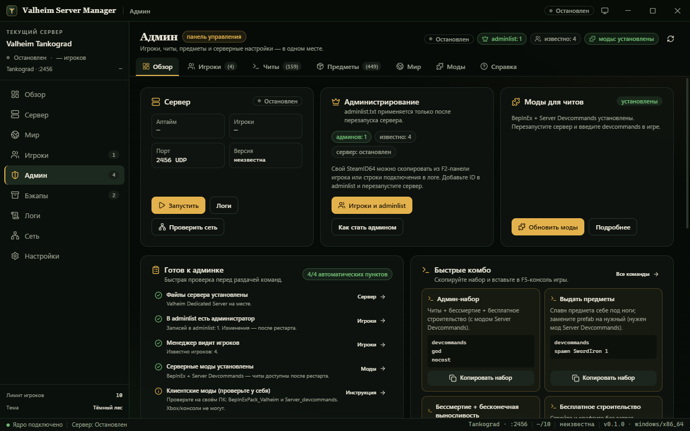
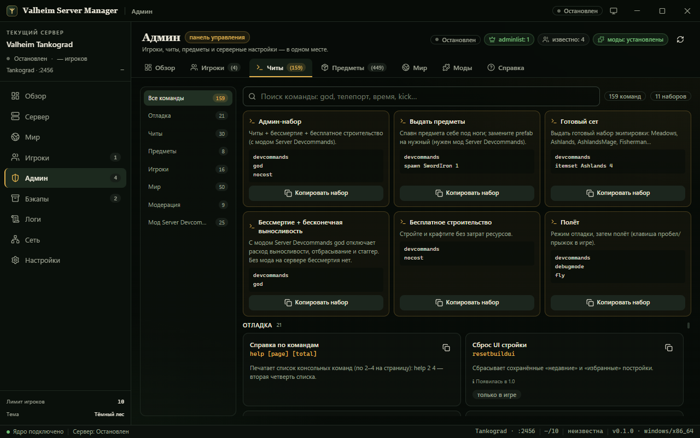
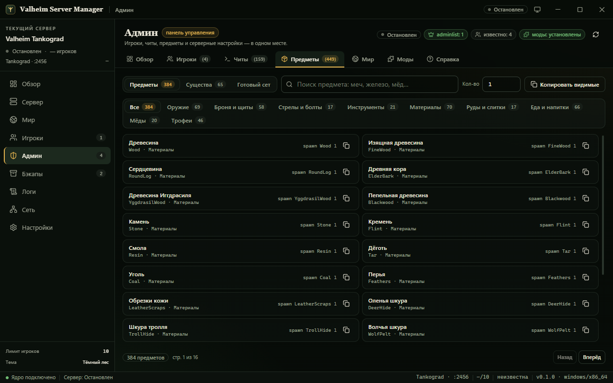
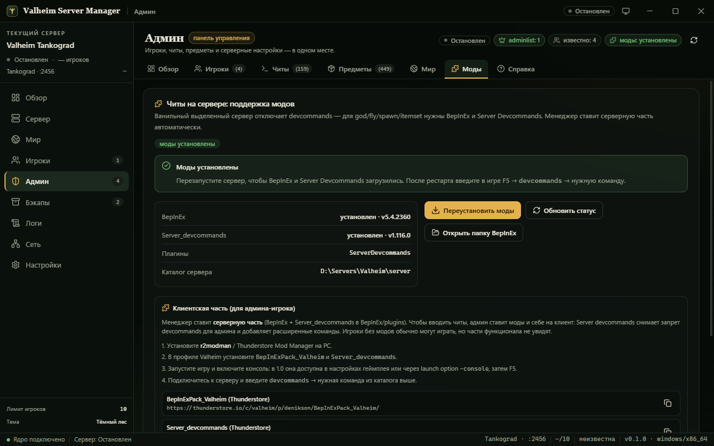

# Valheim Server Manager

<p align="center">
  
</p>

<p align="center">
  <strong>Десктопный менеджер выделенного сервера Valheim для Windows</strong><br />
  Tauri 2 + Rust · React 19 + TypeScript + Vite + Tailwind CSS
</p>

<p align="center">
  <a href="https://github.com/EZUBTS/valheim-server-manager/actions/workflows/ci.yml"></a>
  <a href="https://github.com/EZUBTS/valheim-server-manager/releases/latest"></a>
  <a href="LICENSE"></a>
  <a href="https://www.microsoft.com/windows"></a>
</p>

## Скачать

- **Установщик (MSI)** — [последний релиз](https://github.com/EZUBTS/valheim-server-manager/releases/latest).
- **Portable `.exe`** — в ассетах того же релиза.
- **Архив для друзей** `Valheim-Client-Mods-DragAndDrop.zip` — в ассетах релиза:
  BepInEx + Server Devcommands + [Valheim Admin Tool](https://thunderstore.io/c/valheim/p/QoLTeam/Valheim_Admin_Tool/)
  (панель F7) + её русский перевод. Распаковывается прямо в папку игры.

> Официальные установщики собираются для Windows 10/11 x64. macOS/Linux-сборки
> не публикуются: сервер Valheim и интеграция с Windows-брандмауэром идут только
> под Windows.

Приложение ставит и обновляет Valheim Dedicated Server через SteamCMD, запускает
и останавливает сервер, показывает статус и живой лог, хранит резервные копии
миров, управляет списками игроков и проверяет сеть/брандмауэр — без консоли и
ручного редактирования конфигов.

## Возможности

- **Установка в один клик.** SteamCMD скачивается и распаковывается приложением,
  сервер (`appid 896660`, anonymous) ставится и обновляется кнопкой.
- **Запуск/остановка процесса.** Аргументы командной строки собираются из
  конфигурации: имя, мир, порт, пароль, публичность, crossplay, пресет и
  модификаторы сложности, автосохранение.
- **Статус сервера.** Фаза, PID, аптайм, версия, мир, порт, число игроков,
  последний код выхода и ошибки.
- **Живой лог.** Вывод сервера и SteamCMD в реальном времени, фильтры по
  источнику/уровню, поиск, автоскролл, очистка.
- **Игроки.** Списки админов, забаненных и допущенных (`adminlist.txt`,
  `bannedlist.txt`, `permittedlist.txt`) с валидацией SteamID64.
- **Админка.** Отдельная страница: игроки из логов/истории мира с быстрым
  добавлением в adminlist, каталог 134 консольных команд и 25 команд мода,
  генераторы выдачи предметов (`spawn`, `itemset`; 384 предмета и 65 существ),
  серверные читы мира (`-setkey`: бесплатная стройка, пассивные мобы, без карты,
  события у игроков) и автоматическая установка **BepInEx + Server Devcommands**
  для настоящих читов (god, fly, spawn, dev-команды) на выделенном сервере.
- **Резервные копии.** Zip-архивы миров по кнопке и автоматически перед
  обновлением/остановкой, восстановление, ротация старых копий.
- **Сеть.** Проверка UDP-портов 2456–2458, добавление правил брандмауэра
  Windows, локальные IP, подсказки по пробросу на роутере.
- **Тёмная Valheim-тема**, кастомный титлбар, русский интерфейс.

## Требования

- Windows 10/11 x64, WebView2 Runtime, MSVC Build Tools (для сборки);
- для сборки из исходников: Node.js ≥ 22.12, pnpm ≥ 10, Rust stable
  (edition 2024, MSRV 1.85);
- для игры по сети: открытые **UDP 2456–2458** (см. «Порты и сеть»);
- ~4 ГБ диска под сервер и SteamCMD (плюс место под бэкапы).

## Быстрый старт (разработка)

```bash
pnpm install
pnpm desktop:dev      # полноценное десктоп-приложение (Rust + Vite)
pnpm dev              # только UI в браузере, с демо-данными (preview-режим)
```

Сборка установщика (`.msi`/`.exe` и бандлы других ОС) — в
`src-tauri/target/release/bundle`:

```bash
pnpm desktop:build
```

## Первый запуск

1. Откройте приложение → страница **«Сервер»**.
2. Нажмите **«Установить SteamCMD»** (скачивание ~2 МБ) — приложение само
   распакует его в `D:\Servers\Valheim\steamcmd`.
3. Нажмите **«Установить сервер»** (SteamCMD скачает Valheim Dedicated Server,
   ~2.5–3 ГБ) — файлы появятся в `D:\Servers\Valheim\server`.
4. На странице **«Мир»** задайте имя сервера, мир, пароль (минимум 5 символов),
   порт (по умолчанию 2456), публичность и crossplay, сохраните.
5. На странице **«Обзор»** нажмите **«Запустить»** и дождитесь фазы
   **«Работает»**.
6. На странице **«Сеть»** проверьте порты и при необходимости нажмите
   **«Разрешить в брандмауэре»** (приложение должно быть запущено от
   администратора) — либо добавьте правила вручную.
7. При игре через интернет пробросьте UDP 2456–2458 на локальный IP ПК в
   роутере. Подключайтесь по `IP:2456` либо по коду приглашения при включённом
   crossplay.

> Пароль сервера обязателен: Valheim не запускается без него. При включённом
> crossplay сервер доступен игрокам Xbox/PlayStation/Game Pass по коду
> приглашения.

## Порты и сеть

| Порт        | Протокол | Назначение                                  |
| ----------- | -------- | ------------------------------------------- |
| 2456        | UDP      | основной игровой порт                       |
| 2457        | UDP      | Steam-матчмейкинг (основной порт + 1)       |
| 2458        | UDP      | crossplay/PlayFab, запрос сервера (+ 2)     |

- На практике сервер 1.0.x занимает UDP **2456** (IPv6 dual-stack) и **2457**;
  порт 2458 в обычном режиме не слушается, но Iron Gate рекомендует держать
  открытым весь диапазон 2456–2458 — приложение проверяет его именно так;
- при смене порта на `X` открывайте диапазон `X…X+2`;
- TCP не используется;
- второй сервер на той же машине — порт 2459+ (диапазон 2459–2461);
- при включённом crossplay трафик идёт через PlayFab relay: проброс портов
  **не нужен**, сервер слушает `port+1` + случайные эфемерные порты, игроки
  заходят по **коду приглашения** (6 цифр, меняется после каждого рестарта);
  подключение по локальному IP при crossplay не работает.

Подробнее: [docs/SERVER-SETUP.md](docs/SERVER-SETUP.md),
[docs/ops-findings.md](docs/ops-findings.md).

## Где лежат файлы

Раскладка по умолчанию (`D:\Servers\Valheim`, если каталог существует, иначе
`%LOCALAPPDATA%\com.valheim.servermanager`):

```
<каталог данных>\
├─ server\        # файлы сервера (valheim_server.exe, savedir\, списки игроков)
├─ steamcmd\      # SteamCMD
└─ backups\       # zip-архивы миров
```

- конфигурация: `%APPDATA%\com.valheim.servermanager\config.json`;
- логи сервера: `%LOCALAPPDATA%\com.valheim.servermanager\logs\server\`;
- списки игроков (`adminlist.txt`, `bannedlist.txt`, `permittedlist.txt`) —
  в корне каталога сохранений `server\savedir\`, рядом с `worlds_local\`;
- миры 1.0 — каталоги `worlds_local\<Мир>\` (`_main.N.fwl2/.db2/.chunks/.ok`);
  старые миры-файлы `*.fwl` тоже поддерживаются;
- путь установки и каталоги меняются на странице **«Настройки»**.

## Админка и читы

| Обзор | Читы |
| --- | --- |
|  |  |

| Предметы | Моды |
| --- | --- |
|  |  |

Страница «Админ» — отдельный раздела приложения с собственной навигацией:
**Обзор** (статусы, чек-лист готовности, быстрые комбо), **Игроки**
(поиск/фильтры/adminlist/kick-ban), **Читы** (каталог 159 команд по
категориям), **Предметы** (384 предмета и 65 существ, пагинация, генераторы
`spawn`/`itemset`), **Мир** (`-setkey`-переключатели, пресеты, предпросмотр
аргументов, «Сохранить и перезапустить»), **Моды** (установка BepInEx +
Server Devcommands, статус, клиентская инструкция), **Справка** (FAQ).
Каждый раздел прокручивается внутри своей области — длинной «простыни» нет.

Важное ограничение самой игры: **ванильный выделенный сервер отклоняет
`devcommands` для всех, включая админов** — `god`, `fly`, `spawn`, `item` и
другие читы на нём не работают. Поэтому приложение даёт два уровня:

1. **Без модов** (работает сразу после рестарта сервера):
   - `adminlist.txt` (админ получает модерацию: kick/ban/unban/banned, save);
   - серверные читы мира через `-setkey` — `nobuildcost`, `passivemobs`,
     `nomap`, `playerevents` (плюс пресеты/модификаторы сложности:
     `-preset casual`, `-modifier combat veryeasy`, `-modifier resources most`
     и т.п.) — применяются после перезапуска и действуют на весь мир.
2. **С модами** (кнопка «Установить моды» на странице «Админ»): приложение
   ставит на сервер BepInExPack_Valheim и Server_devcommands с Thunderstore.
   После перезапуска админ в игре (F5 → `devcommands`) получает читы:
   `god` — бессмертие и **без расхода выносливости**, `fly`/`debugmode`,
   `nocost`, `spawn <prefab>`, `itemset`, телепорт и т.д.
   Клиентская часть ставится отдельно на ПК админа (r2modman/Thunderstore:
   BepInExPack_Valheim + Server_devcommands); консоли/Xbox моды недоступны.
3. **Внутриигровая панель (F7)** — **Valheim Admin Tool 0.5.8**: одна панель
   прямо в игре со всеми возможностями админа (читы, предметы, существа,
   навыки, время/погода, скорости, верстаки, инвентарь, world/player tools,
   ESP). Ставится и на клиент, и на сервер; серверная часть включает кик/бан,
   телепорты, глобальное время и сброс дальних зон.
   Интерфейс панели **переведён на русский** отдельным модом-переводчиком
   [`mods/vat-russian`](mods/vat-russian) (BepInEx + Harmony, оригинальный DLL
   мода не изменяется). Подробнее — раздел 11 в
   [docs/ADMIN-REFERENCE.md](docs/ADMIN-REFERENCE.md).

Страница «Админ» содержит: известных игроков (парсинг логов: имя, SteamID64,
последняя активность) с добавлением в adminlist и копированием команд
kick/ban; поиск по 170 командам с копированием; генератор выдачи предметов;
переключатели `-setkey`; статус/установку серверных модов. Полная справка:
[docs/ADMIN-REFERENCE.md](docs/ADMIN-REFERENCE.md), машинные данные
[docs/admin-items.json](docs/admin-items.json).

Клиентская часть (на ПК игрока-админа): архив
`Valheim-Client-Mods-DragAndDrop.zip` из [релиза](https://github.com/EZUBTS/valheim-server-manager/releases/latest) —
его содержимое распаковывается прямо в папку игры (Steam → Valheim →
«Просмотреть локальные файлы»), внутри `ПРОЧТИ-МЕНЯ-КАК-УСТАНОВИТЬ.txt`:
`winhttp.dll`, `doorstop_config.ini`, `.doorstop_version`, `BepInEx/` с
Server Devcommands, **Valheim Admin Tool** (панель F7) и **русским переводом**
панели. Пересобрать архив: `scripts/build-client-mods-zip.ps1`. Локальная
установка на этом ПК: `scripts/install-client-mods.ps1` (добавь
`-ServerPath D:\Servers\Valheim\server`, чтобы установить и серверную часть
панели).

> Обновление приложения и установка модов требуют остановки сервера: при
> закрытии приложения сервер корректно сохраняется и завершается, после чего
> можно ставить моды и снова запускать сервер. Списки игроков применяются
> только при старте сервера.

## Резервные копии и восстановление

- «Бэкапы» → **«Создать резервную копию»** — zip миров из `savedir\worlds_local`
  (`*.fwl`, `*.db`) в `backups\valheim-<мир>-<дата>.zip`;
- включите авто-бэкапы перед обновлением и перед остановкой сервера;
- восстановление доступно только при остановленном сервере; перед заменой
  файлов автоматически создаётся страховая копия.

## Обновление сервера

«Сервер» → **«Обновить сервер»** (`+app_update 896660 validate`). Обновляйте при
остановленном сервере; перед обновлением можно автоматически создать бэкап.

## Скрипты без GUI

В `scripts/` лежат PowerShell-обёртки для тех же операций:

```powershell
.\scripts\install-server.ps1   # SteamCMD + установка/обновление сервера
.\scripts\start-server.ps1     # запуск сервера по конфигурации из раскладки
.\scripts\stop-server.ps1      # остановка сервера
.\scripts\backup-server.ps1    # резервная копия миров
```

Скрипты используют ту же раскладку `server\ / steamcmd\ / backups\`, что и
приложение.

## E2E-проверка

Собранное приложение можно проверить end-to-end на реальном сервере: скрипт
поднимает desktop-приложение с включённым remote debugging WebView2, вызывает
настоящие Tauri-команды через CDP (тот же IPC-путь, что у React-фронтенда) и
прогоняет сценарии — чтение конфигурации/установки, диагностику сети, бэкапы,
а с флагом `-WithServer` — запуск реального сервера, проверку маркеров готовности
и корректную остановку с сохранением мира.

```powershell
# Сборка с CDP-флагом (используется только для тестов, в релиз не попадает)
pnpm tauri build --config src-tauri/tauri.e2e.conf.json
powershell -ExecutionPolicy Bypass -File tools\run-e2e.ps1 -WithServer
```

Результат — `docs/E2E-REPORT.md`. Обычный релиз собирается без
`tauri.e2e.conf.json` (`pnpm desktop:build`) и remote debugging не содержит.

## Документация

- [docs/ARCHITECTURE.md](docs/ARCHITECTURE.md) — архитектура и контракт IPC;
- [docs/SERVER-SETUP.md](docs/SERVER-SETUP.md) — установка, порты, firewall,
  роутер, подключение, обновление, бэкапы, troubleshooting;
- [docs/ops-findings.md](docs/ops-findings.md) — эмпирика на реальном сервере
  1.0.21 (строки логов, тайминги, graceful-стоп, crossplay);
- [docs/SCRIPTS.md](docs/SCRIPTS.md) — PowerShell-скрипты без GUI;
- [docs/valheim-server-reference.md](docs/valheim-server-reference.md) — справка
  по выделенному серверу Valheim со ссылками на источники;
- [docs/E2E-REPORT.md](docs/E2E-REPORT.md) — отчёт end-to-end проверки;
- [docs/ADMIN-REFERENCE.md](docs/ADMIN-REFERENCE.md) — админ-справка: команды,
  читы, ограничения dedicated-сервера, установка модов;
- [docs/admin-items.json](docs/admin-items.json) — машинные данные админки
  (384 предмета, 65 существ, 134 команды).

## Качество и тесты

```bash
pnpm check                                  # typecheck + lint + vitest
(cd src-tauri; cargo fmt --all --check; cargo clippy --all-targets -- -D warnings; cargo test)
```

- фронтенд: React 19, TypeScript 7 (strict), Vite 8, Tailwind 4, Vitest 5;
- бэкенд: Rust edition 2024, clippy pedantic, юнит-тесты конфига/аргументов/логов/
  бэкапов/списков/сети;
- линтеры: oxlint (type-aware) + Prettier, rustfmt + clippy;
- CI: [`.github/workflows/ci.yml`](.github/workflows/ci.yml) — фронтенд (ubuntu) и
  Rust (windows) на каждый push/PR; релизы — [`.github/workflows/release.yml`](.github/workflows/release.yml)
  по тегу `v*` (сборка MSI/NSIS и архива для друзей в GitHub Release).

## Структура проекта

```text
├─ src/                      # React-фронтенд
│  ├─ components/
│  │  ├─ layout/             # титлбар, сайдбар, статус-бар, resize handles
│  │  ├─ pages/              # страницы приложения
│  │  └─ ui/                 # примитивы (button, card, dialog, ...)
│  ├─ hooks/                 # use-server и служебные хуки
│  ├─ lib/                   # типы IPC, обёртки команд, форматирование, preview
│  └─ styles/globals.css     # Tailwind + Valheim-токены
├─ src-tauri/                # Rust-ядро (команды, процессы, логи, бэкапы, сеть)
│  ├─ src/                   # error/paths/config/state/logs/players/worlds/backups/network
│  ├─ src/process/           # сервер Valheim, SteamCMD, graceful-stop helper
│  └─ tauri.e2e.conf.json    # конфиг для e2e (CDP), в релиз не входит
├─ docs/                     # архитектура, справка, setup, эмпирика, e2e-отчёт, релизы
├─ mods/vat-russian/         # мод-переводчик Valheim Admin Tool (BepInEx + Harmony)
├─ scripts/                  # PowerShell-обёртки без GUI, установка модов, сборка архива друзьям
├─ tools/                    # e2e через WebView2 CDP, проверка UI админки
├─ assets/                   # исходник иконки
└─ server/ steamcmd/ backups/ # рабочие каталоги сервера (gitignored)
```

Готовые установщики (после `pnpm desktop:build`):

- `src-tauri/target/release/bundle/msi/Valheim Server Manager_0.1.0_x64_en-US.msi`
- `src-tauri/target/release/bundle/nsis/Valheim Server Manager_0.1.0_x64-setup.exe`
- portable-бинарник: `src-tauri/target/release/valheim-server-manager.exe`

## Известные ограничения

- В первой версии нет установки произвольных модов: поддерживается только
  серверная связка BepInEx + Server Devcommands (для читов); остальные моды
  ставятся вручную, архитектура это допускает.
- Приложение — менеджер: сервер живёт, пока открыто приложение. Закрытие окна
  при работающем сервере спрашивает подтверждение и останавливает сервер
  (с авто-бэкапом, если он включён), чтобы не оставлять процесс-сироту.
- Сервер Valheim не имеет официальной консоли/RCON. Остановка выполняется
  корректно через Ctrl+C-сигнал (проверено: мир сохраняется, процесс выходит за
  ~3 с); при недоступности этого пути используется принудительное завершение.
- Snap Layouts на Windows 11 для frameless-окна не поддерживается (ограничение
  кастомного титлбара).
- Проброс портов на роутере приложение не делает — оно проверяет правила
  брандмауэра и подсказывает, что открыть.
- Crossplay: код приглашения меняется после каждого перезапуска сервера.

## Troubleshooting

- **Сервер не виден в списке** — проверьте UDP 2456–2458 (брандмауэр и роутер),
  `-public 1`; при crossplay используйте код приглашения.
- **«Порт занят»** — остановите другой сервер/процесс или выберите свободный
  порт (например, 2459).
- **Брандмауэр: отказ в доступе** — запустите приложение от имени администратора
  или добавьте правила вручную (`docs/SERVER-SETUP.md`).
- **Сервер не стартует после обновления** — проверьте лог на странице «Логи»,
  обновите сервер кнопкой (validate), проверьте пароль/имя мира.
- **Долгая установка** — SteamCMD качает ~2.5 ГБ; прогресс виден в логах и на
  странице «Сервер».

## Лицензия

[MIT](LICENSE) © 2026 ezubts. Valheim и Valheim Dedicated Server — товарные
знаки Iron Gate AB; проект не связан с Iron Gate AB и не одобрен ею.

Сторонние моды (BepInEx, Server Devcommands, Valheim Admin Tool и др.)
распространяются их авторами по собственным лицензиям и в репозиторий не
входят — скрипты и архив для друзей скачивают их с официальных источников.